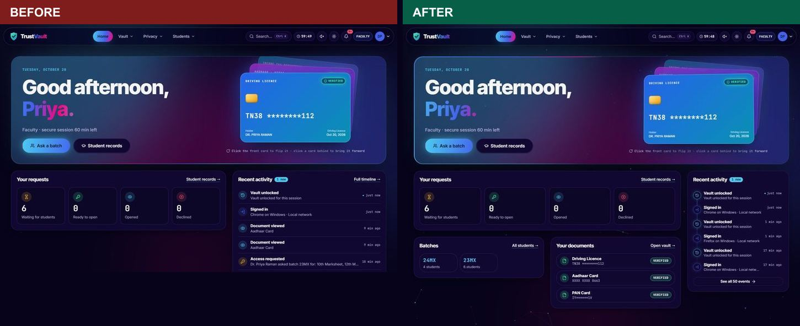
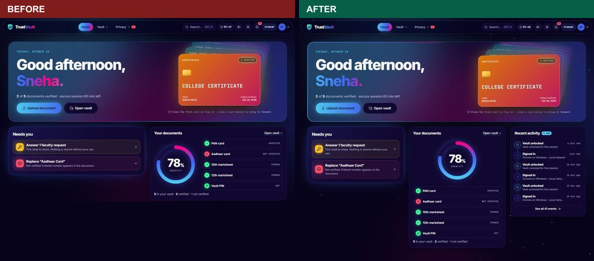
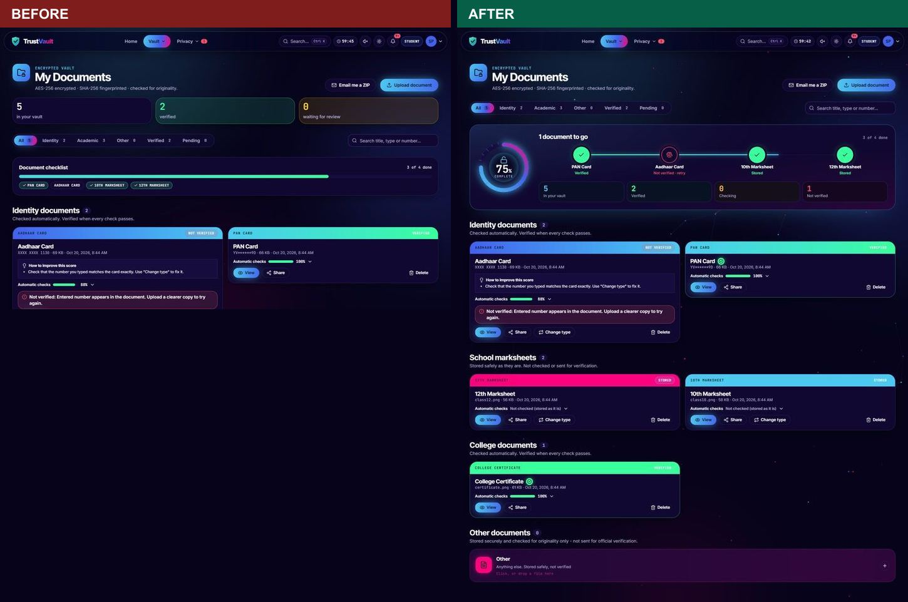
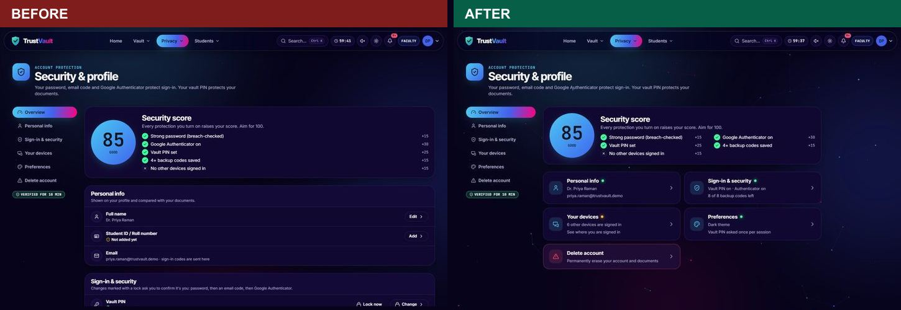
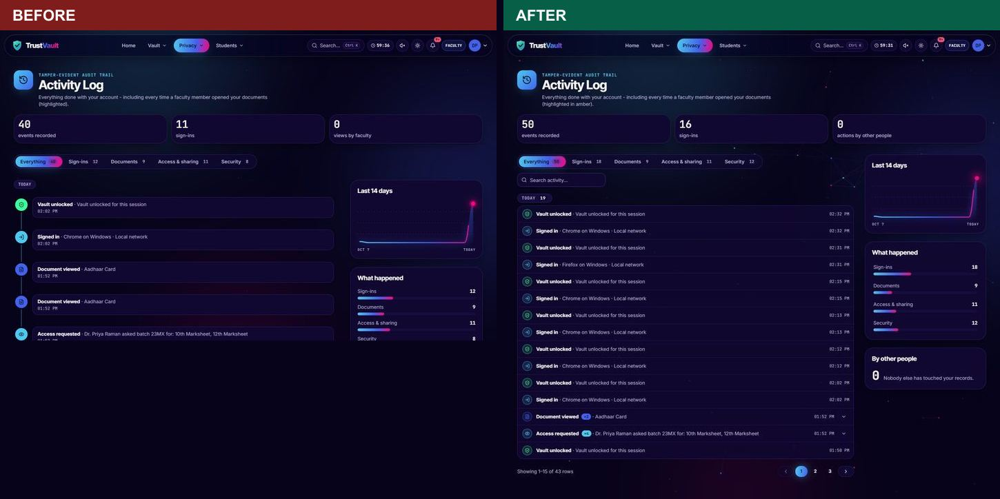
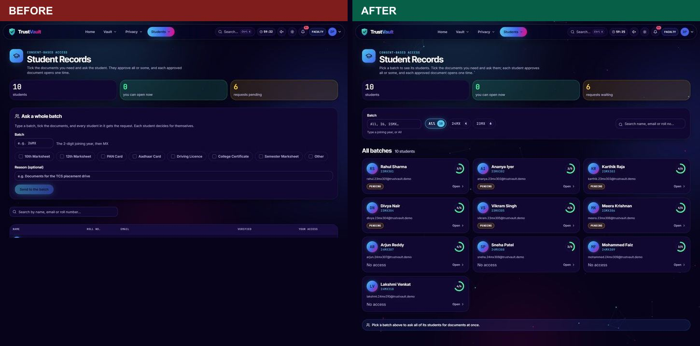

# Sprint 2 review and retrospective - UI review sprint (20 Oct 2026)

Backlog and acceptance criteria: [sprint-2-backlog.md](sprint-2-backlog.md).

**Result:** all 9 stories and both bugs done. 2 more bugs found and fixed during testing (see below).

## Story by story

| ID | Story | Status | What changed |
|---|---|---|---|
| US-1 | Home shows only what matters | Done | One main column (student: *Needs you* + *Your documents*; faculty: *Your requests* + *Batches* + *Your documents*; administrator: *College at a glance* with the waiting requests + *Your documents*) and a narrow *Recent activity* column on the right that stays in view while scrolling. No empty area under the cards. |
| US-2 | Compact recent activity | Done | At most 6 rows on a small timeline; repeats grouped with a count (a batch request to 4 students = **Access requested ×4**); "See all N events" opens the log. |
| US-3 | Interactive vault | Done | **Vault status** panel: animated completion ring (lock closes at 100%), the required documents as a step track (a missing one is a button that opens upload for that type), live counts. Cards rise in one after another, tilt toward the pointer, shimmer on hover, verified ones carry a seal. **Drag-and-drop**: drop a file anywhere for a "drop to upload" overlay; drop on a slot to pick its type (the type is otherwise guessed from the file name). Empty slots breathe and float. |
| US-4 | Security & profile one section at a time | Done | Tabs with their own links (`/security?tab=devices`); Overview = score + one tile per section with its state; each tab shows only its section; Back works; "Sign out all other devices". |
| US-5 | Activity log easy to scan | Done | Compact one-line rows grouped by day, repeats grouped (open to see each), search, category filters with counts, pages of 15, summary panel beside the list. Two lines per row on phones. |
| US-6 | Batch filter for faculty | Done | Batch chips (All, 24MX, 23MX… with counts) and a Batch box that accepts `26`, `26MX` or `All`; the batch's students as profile cards (initials, roll number, verified-documents ring, access status); unknown batch → "No students in 26MX yet" + buttons for the batches that exist; **Ask all N students in 23MX** form under the cards (hidden for All). Server: `GET /records/batches`, `GET /records/students?batch=`. |
| US-7 | Moving background | Done | A slow constellation (points of light that link up and lean toward the pointer) over the existing aurora; 30 fps, paused in hidden tabs, still with reduced motion. |
| US-8 | CI/CD | Done | GitHub Actions: unit + build, end-to-end, browser tests in parallel; deploy only from `main` after all pass; Render set to deploy only after checks pass. See [ci-cd.md](ci-cd.md). |
| US-9 | Cross-platform | Done | Chrome, Edge, Firefox; 1900, 1366, 768 (new) and 390 px; dark and light. |
| BUG-1 | Roll-number warning for staff | Fixed | Faculty/administrators see *Role* instead; the profile form only asks students for a roll number. |
| BUG-2 | Student sections in staff vaults | Fixed | Staff see Identity and Other only; their status track is PAN, Aadhaar, Driving Licence. |

## Before and after

Home (faculty) - activity is a short column next to the requests; batches and documents fill the space:

Home (student):

Vault:

Security & profile - Overview is a summary; each section opens on its own:

Activity log - one line per event, repeats grouped, pages:

Student records - batch chips and profile cards:

## Test evidence

| Suite | Before sprint | After sprint |
|---|---|---|
| Unit (`npm test`) | 7 | **10** (event grouping) |
| End-to-end API (`npm run test:e2e`) | 133 | **140** (batches list, `?batch=23`, empty batch, All, malformed batch, students blocked) |
| Browser, Chrome (`npm run test:ui`) | 30 | **44** (vault status, missing-document button, drag-and-drop upload, security tabs + deep link, short activity column, batch typing, empty batch suggestions, All) |
| Browser, Edge (`CHROME_PATH=…msedge.exe npm run test:ui`) | - | **44** |
| Firefox (WebDriver BiDi script) | - | 5 signed-in pages render, no console errors |

Screen sizes in the browser suite: 1900×940, 1366×700, **768×1024 (added this sprint)**, 390×844; dark and light; student, faculty, administrator and guest.

**Performance** (Chrome, signed in, scrolling each page top to bottom and back): Home, Vault, Activity and Security all **60 fps with 0 dropped frames**, with the moving background on.

## Bugs found by the new tests (and fixed)

1. **Security slid sideways on tablets and phones** - the tab animation entered from 24 px to the right and briefly overflowed. Now it rises vertically. Found by the new 768 px size in Edge.
2. **Administrator home was 18 px too wide on phones** - a long "X asked Y" line stretched a grid with no column limit. All the new grids now have a shrinkable single column on small screens.
3. **The browser tests could not sign in on Edge** (the app could): Edge opens its own start tab, so the test's tab ran in the background, where browsers pause animation frames, and the hold-to-enter button never filled. The test runner now brings its tab to the front. Traced by replaying the same sign-in in Edge against the live site, step by step.
4. Found while checking screenshots: the recent-activity card was pushed 96 px down (a sticky style was overridden by the card's hover-light effect), and the vault ring's lock icon was drawn at ring size. Both fixed.

## Retrospective

**Went well**
- Turning the owner's review straight into stories with acceptance criteria made each change easy to check.
- Before/after screenshots and the new browser checks caught layout problems no unit test would.
- Adding one screen size (tablet) found a real bug immediately.

**To improve**
- Tests that run while code is being edited give noisy failures; run the final suites only after the last edit.
- Demo data collects test sign-ins in the faculty activity log; reset it with `npm run demo` before showing the app.
- Firefox is checked with a separate script; folding it into `npm run test:ui` (WebDriver BiDi) would make it part of CI.

## Proposed for the next sprint

| Idea | Why |
|---|---|
| Firefox in the CI browser job | Same checks on a second engine on every push |
| Accessibility audit (axe-core) in CI | Catch missing labels and contrast automatically |
| Notifications page (all alerts in one list, mark as read) | The bell shows 9+ with nowhere to see them all |
| Faculty "requests" page (every request, filter by batch and status) | Today only the counts are on Home |
| Phone: swipe between Security tabs | Feels native on the APK |
