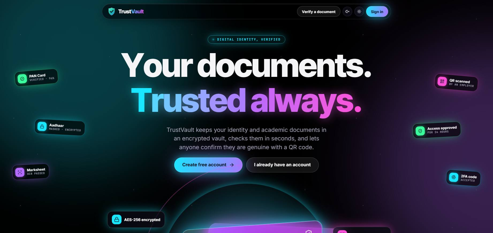
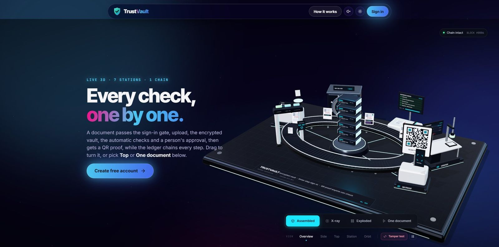
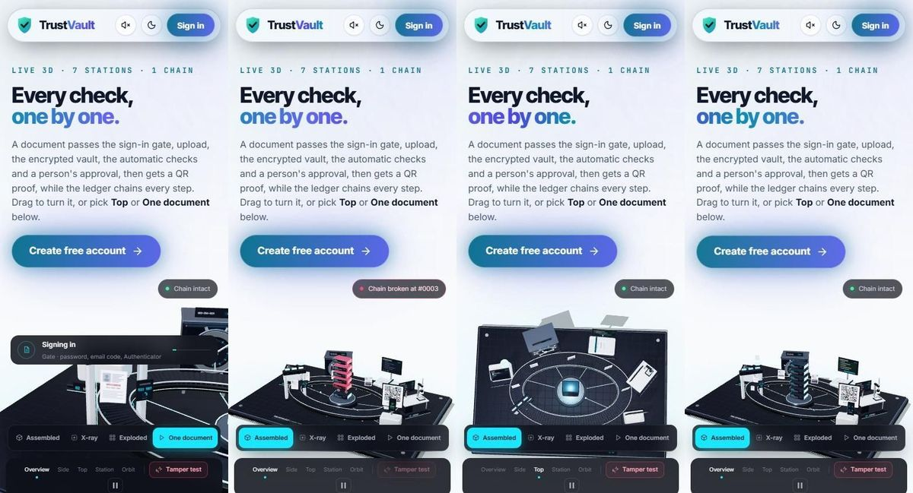
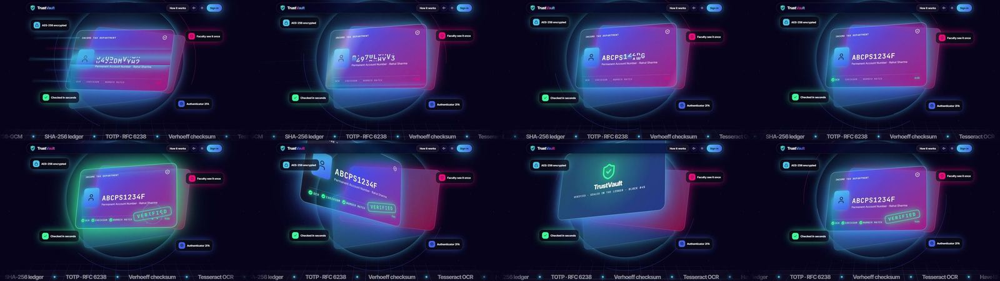

# Sprint 3 review and retrospective - main page motion (20 Oct 2026)

Backlog and acceptance criteria: [sprint-3-backlog.md](sprint-3-backlog.md).

**Result:** all 3 stories done. 5 problems found while checking frames in a real browser, all fixed before release.

## Story by story

| ID | Story | Status | What changed |
|---|---|---|---|
| US-1 | 3D vault, first screen | Done | `client/src/components/ui/trustvault-3d.jsx` (three.js, from the owner's brief) is the first section of the main page: the headline "Every check, one by one." and *Create free account* on the left, the machine on the right (stacked on phones). Modes, views, Top, One document and Tamper test all work; the chain-status pill stays in view. Changes to the brief's `embed` mode for a first screen: the mode bar, journey and status stay visible, the wheel and a vertical swipe scroll the page while a sideways drag turns the machine, and the camera sits a little further back so the plate is not cut off. three.js is its own 173 KB (gzipped) download, fetched only by the main page; the main bundle is unchanged at 102 KB. No WebGL 2 → the page starts with the hero, no error box. |
| US-2 | Hero card show | Done | `client/src/pages/landing-hero.jsx`: flies in from the left with motion streaks, ten slot-machine reels lock on ABCPS1234F while the score flickers, the three checks tick on as the score counts to 96%, VERIFIED slams down with a spark burst, then one 360° turn shows a TrustVault back. Starts when the card is in view (after the first-visit intro). Scrolling past slides it left and back. Reduced motion: the finished card. |
| US-3 | Ship | Done | New browser check for the 3D section; all suites green on Chrome, Edge and Firefox; pushed to GitHub (CI runs the suites again and deploys only when they pass). |

## Before and after

Before - the first screen was the headline and the top of the card:

After - the 3D vault comes first:

Phone, light theme - One document, Tamper test, Top view, Assembled:

The hero card show (fly-in, reels, locked, checks, VERIFIED, turn, back face, settled):

## Test evidence

| Suite | Before sprint | After sprint |
|---|---|---|
| Unit (`npm test`) | 10 | 10 |
| End-to-end API (`npm run test:e2e`) | 140 | 140 |
| Browser, Chrome (`npm run test:ui`) | 44 | **46** (3D vault first on the page, One document, Top view, tamper breaks the chain, the wheel is not captured; dark and light) |
| Browser, Edge | 44 | **46** |
| Firefox (WebDriver BiDi script) | 5 pages | Main page: 3D vault first and drawn, hero card reaches VERIFIED, no console errors |

Frames were captured in headless Chrome at 1900, 1366, 768 and 390 px in both themes; no sideways scroll at any size.

## Problems found while checking frames (fixed)

1. **The card cut through the cards behind it while turning** - half of it swung behind the pink back card. The card now lifts toward the viewer during the turn.
2. **VERIFIED and 96% were hard to read in light mode** - the light theme's darker green sat on the dark card. The card keeps a bright green in both themes.
3. **On phones the 3D stage was mostly empty** - the machine is sized to the screen width, so a tall stage left a gap. The stage height now follows the width.
4. **In light mode the 3D view buttons and the One-document panel were white text on a white page.** They now sit on the same dark glass as the mode bar.
5. On a 1366×768 laptop the hero card was entirely below the fold, so a show that started "on page open" would have finished unseen; it now starts when the card comes into view.

## Retrospective

**Went well**
- Asking the owner two questions (when it plays, which spin) before building avoided a rebuild.
- Frame-by-frame captures caught all four visual bugs before any user saw them.

**To improve**
- The 3D scene renders slowly in headless browsers (software graphics), so its browser check jumps the animation clock instead of waiting.
- Firefox is still a separate script; folding it into `npm run test:ui` remains on the list.
